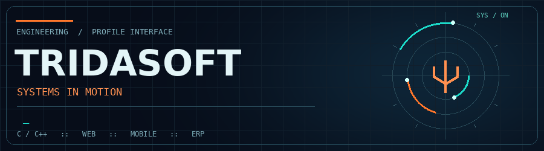
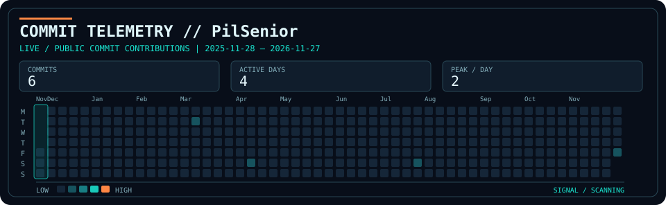

<div align="center">



</div>

## `01 / IDENTITY`

```text
> whoami
  Software Developer  /  Tridasoft
  Focus               /  Engineering practical digital systems
  Learning            /  42 curriculum, C and C++
  Location            /  Türkiye
  Mission             /  Turn operational complexity into usable software
```

I build software at the intersection of systems programming, business automation and real-world operations. My focus is on turning complex workflows into reliable, maintainable digital products, from low-level code to web and mobile applications.

## `02 / ENGINEERING STACK`

| Domain | Tools & technologies |
| :--- | :--- |
| Systems programming | `C` · `C++` · `Makefile` · `Linux` |
| Web & mobile | `Web development` · `Mobile applications` |
| Data & integration | `SQL Server` · `APIs` · `Business workflows` |
| Infrastructure | `Git` · `PowerShell` · `Linux` |
| Engineering interests | `Route optimization` · `ERP automation` · `AI systems` |

## `03 / PROJECT RADAR`

| Module | Description |
| :--- | :--- |
| **`ROUTE_ENGINE`** | Route optimization for distribution and field sales operations, with location tracking and operational efficiency as core goals. |
| **`TRIDASOFT`** | Web and mobile development, ERP automation and business-oriented digital solutions. |
| **`42_CORE`** | Systems programming practice through Libft, ft_printf, get_next_line, Born2beroot, Minitalk and so_long. |
| **`AI_EXPLORATION`** | Exploring intelligent software systems and applied AI research. |

## `04 / ENGINEERING PROTOCOL`

```cpp
// Engineering philosophy — illustrative pseudocode
while (building) {
    understand_the_problem();
    design_the_solution();
    implement_with_precision();
    test_in_real_conditions();
    improve_continuously();
}
```

## `05 / OPEN CHANNEL`

Interested in software engineering, business automation and projects that solve real operational problems.

## `06 / COMMIT TELEMETRY`

<div align="center">



[GitHub profile / PilSenior](https://github.com/PilSenior)

</div>

The calendar tracks public commit contributions recognized by GitHub over the last 365 days, not issues or pull requests. It is refreshed daily by GitHub Actions. The initial image is explicitly labeled as demo data until the first successful sync.


<div align="center">

**BUILD WITH PURPOSE. ENGINEER FOR IMPACT.**

</div>
